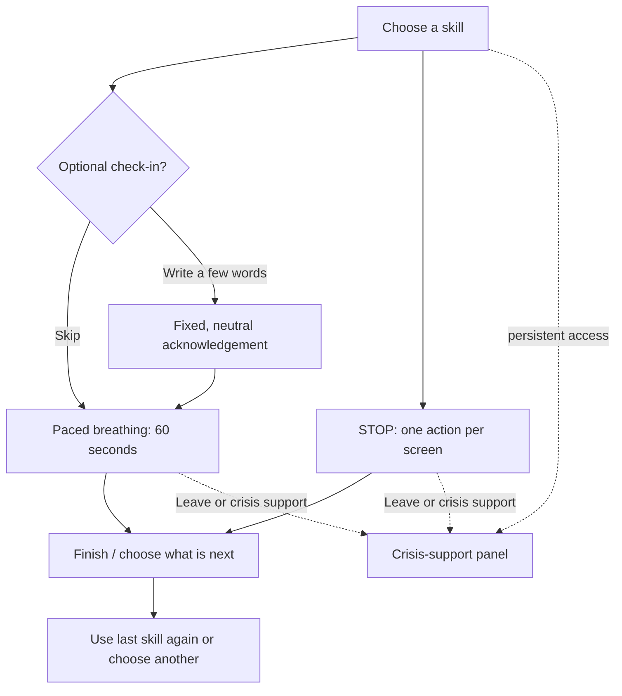

# Quiet Steps — Research and Design Notes

## Design intent

Quiet Steps is a calm, mobile-first skills-practice prototype. It supports a person who wants a brief, self-directed pause without asking them to explain or disclose anything. It is a coursework concept, not a clinical intervention or emergency service.

## Main experience flow

### Designed screens

1. **Choose a skill** — choose paced breathing or STOP; communicate that check-in is optional and the design is a coursework prototype.
2. **Optional check-in** — free text is optional; a person can continue without sharing.
3. **Paced breathing** — a 60-second visual 4-in/6-out practice, with leave and crisis-support controls.
4. **STOP: Observe** — one discrete prompt rather than an overloaded sequence.
5. **Finish and continue** — optional device-local recent-session reminder and a low-effort “use last time's skill” choice.
6. **Crisis support** — visible independently from the check-in/model feature and framed as a prototype disclosure.

## Model role and data plan

### Model role

The model is not implemented at this milestone. If implemented, it would only respond to optional check-in text with:

- a short neutral acknowledgement; and
- one skill suggestion selected from a fixed allowlist: paced breathing or STOP.

It must never diagnose, assess risk, offer therapy or medical advice, decide whether someone may leave, hide crisis support, or present itself as emergency care.

### Data expected to be stored

The smallest useful data approach is preferred:

| Data | Purpose | Storage proposal |
| --- | --- | --- |
| Last selected skill | Offer “use last time's skill” | Optional, device-local preference only |
| Optional recent-session label and duration | Let a person recognize a completed practice | Optional, device-local only, clearable |
| Free-text check-in | None after generating an in-session acknowledgement | Do not persist |
| Crisis-support use, location, identity, or health profile | None | Do not collect |

## Personalization and user control

- Every practice begins with a choice, not an automated recommendation.
- Check-in is optional and skippable.
- “Use last time's skill” is a small convenience, not a profile or configuration burden.
- A person can leave at any time and should be able to clear any optional local history.
- Crisis support is directly reachable on every main practice screen.

## Research and design connections

| Finding | Design response |
| --- | --- |
| **R1 — Short practices are easier to complete.** | Paced breathing is bounded to 60 seconds and shows six short cycles. |
| **R2 — Reaching support should not require navigating a model conversation.** | Crisis support is a persistent, independent control. |
| **R3 — People need permission to stop or leave.** | Breathing and STOP screens use visible “Leave exercise” controls and non-judgmental exit language. |
| **R4 — People should direct their own path.** | The entry screen offers skills directly and never requires check-in. |
| **D1 — As distress rises, reduce interface complexity.** | Skill screens remove unnecessary choices and visual noise. |
| **D2 — One atomic action at a time.** | The STOP flow dedicates a screen to one step, such as Observe. |
| **D3 — Reduce emotional cost.** | Prompts are brief and avoid asking for detailed disclosure. |
| **D4 — Keep safety visible.** | A consistent crisis-support control appears in the primary experience. |
| **D5 — Personalize without a setup burden.** | Repeating a last-used skill is optional, local, and easy to bypass. |
| **D6 — Use low-stimulus, non-judgmental language.** | The visual system uses a soft palette, generous spacing, and calm plain-language copy. |

## Questions to resolve before implementation

1. Which region-appropriate crisis resources should appear in a real implementation, and how will they be kept current?
2. Does the optional local history genuinely help people, or does it add avoidable sensitivity and complexity?
3. What wording and visual pace feel clearest in usability testing for the 4-in/6-out breathing exercise?
4. How should the full STOP sequence be tested so each screen remains understandable without feeling mechanical?
5. What evidence is needed to demonstrate that the fixed-response model boundary is actually enforced in code?

## Part 3.2 implementation supplement

The local prototype implements the proposed choice, check-in, paced-breathing, STOP, completion, and crisis-support screens as a Vue frontend backed by FastAPI and SQLite. The visual implementation follows the six-screen Figma reference: off-white mobile canvas, rounded low-stimulus cards, green primary actions, rose crisis actions, generous spacing, and one discrete STOP action per screen.

### Implemented boundaries

- **Dashboard, appearance, and navigation:** the home screen uses a daily-check-in entry, a featured practice card, and links to chat, practice days, all activities, and non-identifying profile setup. When Paced Breathing is featured, nine nested background circles follow the same 4-second expansion/6-second settling cue used by the exercise; they are decorative, have no timed action, and become still for reduced motion. A persistent icon navigation bar provides Home, Activities, Chat, Calendar, Profile, and Crisis routes on non-exercise screens; it deliberately disappears during check-in and skill flows so the dedicated Leave and Crisis Support controls remain the clearest actions. Profile setup presents Night sky, Snowy Winter, Fall, and Spring; the selected appearance updates the shared visual tokens and is kept only as a non-sensitive browser preference. Each selected theme adds a non-semantic background layer: a static starry night for Night sky, falling snow for Snowy Winter, drifting leaves for Fall, or a small repeating floral print for Spring. The motion effects become still when the person selects less motion or their device requests reduced motion; the layer is not rendered on active skills, check-in, or Crisis Support screens. The **Your days** calendar has month navigation, separately marked activity records, and an optional, deliberate daily mood choice.
- **Anonymous preference profile and adaptation:** the local SQLite database holds one accountless profile row with only a voluntarily selected preferred skill, a motion preference, and an opt-in flag for practice-context chat suggestions. It has no name, account, contact information, location, health answers, check-in text, or crisis activity. Home features the selected practice when present; otherwise it features the most recent **completed** skill, then falls back to paced breathing. The feature card always provides **Choose another activity** and **Change preference**, and Profile provides **Clear practice preferences**, so no recommendation restricts the person’s choice. A user-selected less-motion preference stops the breathing-circle animation while preserving the text and numeric pacing cue; a device-level reduced-motion setting still takes precedence.
- **Optional profile reflection:** Profile offers four original, optional present-moment statements with one shared four-choice response format. The prompt wording and response labels are the prototype's own; this uses only the high-level present-moment/four-choice structure as a reference. It is not the STAI, does not reproduce, administer, or score a standardized instrument, produces no result or conclusion, and can be skipped or cleared. Normally responses remain only in the open Profile screen. A person may explicitly choose **Use selected responses in Check-in Chat**, which copies only the selected labels into browser memory for one next chat request and clears them before the request completes. FastAPI uses a transparent app-owned rule to pick one of the two practices: “Mostly” or “Very much” for body tension or feeling on edge suggests Paced Breathing; every other selected pattern suggests STOP. This is a starting-point rule, not a health inference, and the person can always choose either skill. The selected labels are never written to SQLite, added to chat history, or sent to the RAG model; they are discarded after that request.
- **Paced breathing:** six 4-in/6-out cycles, for 60 seconds total. The timer begins after the first “Breathe in” instruction is rendered and ends after the sixth exhale; no additional dwell is planned, so the full intended exercise is 60 seconds (below the 90-second limit). The circle expands with an inhale count-up from 1 to 4 and settles with an exhale countdown from 6 to 1. Only that final planned step records a completion. It can be paused or left at any time; leaving returns immediately and records a voluntary exit in the background. The backend accepts no recorded duration above 90 seconds.
- **Optional check-in:** the UI can always continue with no text. The routine backend mode is deterministic and mocked. A separately configured fictional live-demo mode may receive text only for the request, but its JSON output is rejected unless it contains exactly one approved neutral acknowledgement and one allowlisted skill suggestion. Invalid or unavailable output uses a fixed safe fallback. Neither mode diagnoses, assesses risk, offers therapy or medical advice, makes treatment claims, or routes a person anywhere.
- **Daily mood calendar:** a person may select one of five plain-language labels — **Very low**, **Low**, **In between**, **Good**, or **Very good** — for a calendar day. Distinct outlined face icons support the choices while their text labels remain available. The calendar uses outlined month chevrons, a green dot for a self-reported mood, and a neutral dot for a saved activity. This is an optional self-report, not an assessment, score, prediction, diagnosis, or claim that a skill caused a change. The calendar stores only the selected date, one selected label, and an update timestamp; it has no note/free-text field. A person can revise the label, remove a selected day, or clear all mood entries. Mood entries do not affect the featured practice, are never passed to either optional model path, and do not influence Crisis Support.
- **Local history:** SQLite retains session timestamps, chosen skill, completion/leave state, duration, a check-in-submitted marker, and the fixed acknowledgement/suggestion. It does not retain user check-in text, location, identity, crisis-support activity, or free-text health information. The only self-report added for the daily calendar is the explicit single-label mood choice described above. The dedicated **View local history** screen shows session metadata and fixed allowed responses, supports repeating a prior skill, and exposes a clear-history action. SQLite records remain available after the API restarts.
- **STOP flow:** the application owns an immutable, four-step sequence — Stop, Take a step back, Observe, Proceed mindfully. It presents one step at a time with Continue, Back (after the first step), Leave exercise, and Crisis Support controls. The optional check-in has no access to this sequence and cannot generate advice or change it.
- **Reviewed chat research context:** When chat suggests a practice, it adds a direct link to a small, app-authored research note. Paced Breathing cites Bentley et al.’s 2023 systematic review, which describes guided slower breathing programs and notes that its reviewed programs were generally at least five minutes; ClearSpace therefore calls its 60-second sequence a brief practice rather than claiming the review’s outcomes. STOP cites Gasol et al.’s 2022 school DBT-skills study, which reported acceptability alongside preliminary/mixed outcome findings from a 30-lesson program; the app describes STOP as a short structured walkthrough, not that curriculum or a treatment. These notes are not model output, do not use personal data, and do not change the activity suggestion.
- **Crisis support:** each main screen has an independent crisis-support control, including while an optional check-in is loading or uses its fallback. For this U.S.-configured coursework prototype, it shows 911 for immediate danger, 988 for the 988 Lifeline, and a trusted-person contact link. The source is the official [988 Lifeline Get Help page](https://988lifeline.org/get-help/), checked during implementation. It is not controlled by the model, session state, or database; the application neither identifies location, records use of the panel, nor monitors anyone.
- **Failure handling:** API/database failure leaves the practice usable and shows plain-language feedback; optional-check-in unavailability substitutes a deterministic safe fallback; opening crisis support pauses breathing rather than allowing an exercise timer to continue unseen.

The local check-in adapter is intentionally a testable stand-in, not a deployed clinical or generative service. Any future provider integration must preserve the fixed acknowledgement plus allowlisted-suggestion boundary and the non-persistence rule.

### Crisis-support jurisdiction and limitation

The visible resources are intentionally labeled **“U.S. prototype information.”** They are appropriate only for the United States and its territories; that jurisdiction was selected because the official 988 Lifeline describes 988 call, text, and chat options there. The screen also says that a real deployment outside this jurisdiction requires separately selected and verified local resources. It is not location-aware, does not claim to be emergency care, and cannot replace current regional resource review.

## RAG chatbot addendum — fictional coursework conversations

The assignment’s conversation/RAG requirement is implemented as a separate
**Fictional RAG chat** path. This does not change the privacy behavior of the
optional skills check-in: check-in text remains non-persistent. The RAG chat
explicitly labels that it is for fictional scenarios and stores its user and
assistant messages locally because reconstruction and retrieval require that
context. The UI exposes message IDs, time, state, cited records, saved-chat
selection, and a clear-saved-chats control.

For each chat message, the backend saves a `pending` record, makes a
model-proposed retrieval-plan call, validates a single exact read-only `SELECT`
template, binds the current conversation ID and row limit itself, and retrieves
at most six records. A second model call receives only the selected records and
reviewed prototype constraints. When the person explicitly enables it in
Profile, that call may also receive an application-generated, non-sensitive
summary containing only the selected preferred skill, the latest completed
skill, and per-skill completed-practice counts. The RAG model never receives
profile reflection answers, optional check-in text, crisis-support use,
location, or identity. A separate explicit one-request reflection handoff is
handled by application code before any model call. The model must return a
short response, an allowlisted skill, and only cited IDs drawn from those
selected rows. When a suggestion is rendered, Vue adds a reviewed,
application-owned explanation of that chosen practice and its controls; this
detail does not come from the model, does not change either exercise sequence,
and cannot introduce clinical advice. FastAPI validates all
of those fields before one transaction completes the user message and saves the
assistant reply. Invalid plans, model/provider failure, and invalid output leave
the user message marked `failed` and save no invented assistant reply.

This adds useful saved context at the cost of retaining the content of fictional
chat messages and transmitting the selected context to OpenAI in explicit live
mode. The design therefore keeps chat optional, labels its data behavior, uses
fictional test inputs only, provides deletion, and leaves Crisis Support wholly
independent. [design-pipeline.md](design-pipeline.md) records the API, schema,
query contract, and failure handling in detail.
