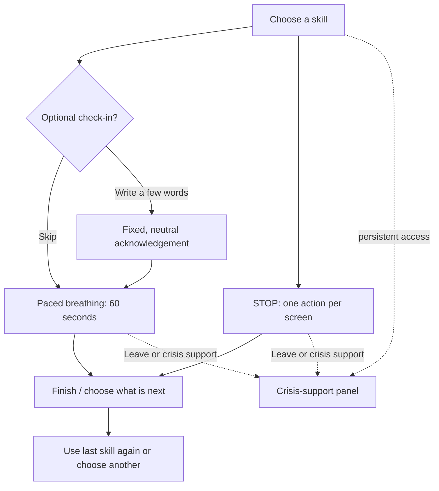

# Quiet Steps — Research and Design Notes

## Design intent

Quiet Steps is a calm, mobile-first skills-practice prototype. It supports a person who wants a brief, self-directed pause without asking them to explain or disclose anything. It is a coursework concept, not a clinical intervention or emergency service.

## Main experience flow

### Designed screens

1. **Choose a skill** — choose paced breathing or STOP; communicate that check-in is optional and the design is a coursework prototype.
2. **Optional check-in** — free text is optional; a person can continue without sharing.
3. **Paced breathing** — a 60-second visual 4-in/6-out practice, with leave and crisis-support controls.
4. **STOP: Observe** — one discrete prompt rather than an overloaded sequence.
5. **Finish and continue** — optional device-local recent-session reminder and a low-effort “use last time's skill” choice.
6. **Crisis support** — visible independently from the check-in/model feature and framed as a prototype disclosure.

## Model role and data plan

### Model role

The model is not implemented at this milestone. If implemented, it would only respond to optional check-in text with:

- a short neutral acknowledgement; and
- one skill suggestion selected from a fixed allowlist: paced breathing or STOP.

It must never diagnose, assess risk, offer therapy or medical advice, decide whether someone may leave, hide crisis support, or present itself as emergency care.

### Data expected to be stored

The smallest useful data approach is preferred:

| Data | Purpose | Storage proposal |
| --- | --- | --- |
| Last selected skill | Offer “use last time's skill” | Optional, device-local preference only |
| Optional recent-session label and duration | Let a person recognize a completed practice | Optional, device-local only, clearable |
| Free-text check-in | None after generating an in-session acknowledgement | Do not persist |
| Crisis-support use, location, identity, or health profile | None | Do not collect |

## Personalization and user control

- Every practice begins with a choice, not an automated recommendation.
- Check-in is optional and skippable.
- “Use last time's skill” is a small convenience, not a profile or configuration burden.
- A person can leave at any time and should be able to clear any optional local history.
- Crisis support is directly reachable on every main practice screen.

## Research and design connections

| Finding | Design response |
| --- | --- |
| **R1 — Short practices are easier to complete.** | Paced breathing is bounded to 60 seconds and shows six short cycles. |
| **R2 — Reaching support should not require navigating a model conversation.** | Crisis support is a persistent, independent control. |
| **R3 — People need permission to stop or leave.** | Breathing and STOP screens use visible “Leave exercise” controls and non-judgmental exit language. |
| **R4 — People should direct their own path.** | The entry screen offers skills directly and never requires check-in. |
| **D1 — As distress rises, reduce interface complexity.** | Skill screens remove unnecessary choices and visual noise. |
| **D2 — One atomic action at a time.** | The STOP flow dedicates a screen to one step, such as Observe. |
| **D3 — Reduce emotional cost.** | Prompts are brief and avoid asking for detailed disclosure. |
| **D4 — Keep safety visible.** | A consistent crisis-support control appears in the primary experience. |
| **D5 — Personalize without a setup burden.** | Repeating a last-used skill is optional, local, and easy to bypass. |
| **D6 — Use low-stimulus, non-judgmental language.** | The visual system uses a soft palette, generous spacing, and calm plain-language copy. |

## Questions to resolve before implementation

1. Which region-appropriate crisis resources should appear in a real implementation, and how will they be kept current?
2. Does the optional local history genuinely help people, or does it add avoidable sensitivity and complexity?
3. What wording and visual pace feel clearest in usability testing for the 4-in/6-out breathing exercise?
4. How should the full STOP sequence be tested so each screen remains understandable without feeling mechanical?
5. What evidence is needed to demonstrate that the fixed-response model boundary is actually enforced in code?
